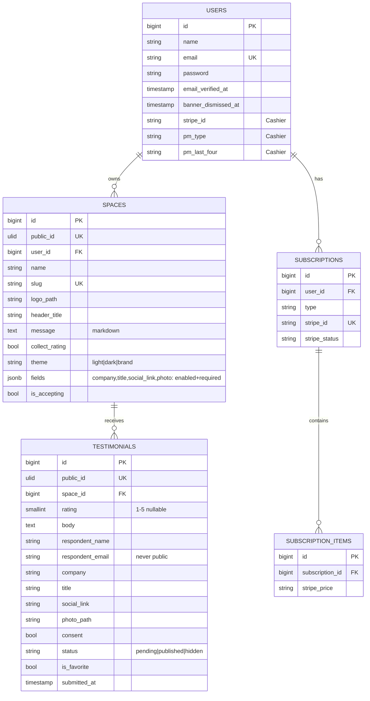

# Data model

Indexes: `spaces(slug)`, `spaces(user_id)`, `testimonials(space_id, submitted_at)`, `testimonials(space_id, status)`.
Rules: name + email are always collected; `fields` only configures optional ones. Deleting a space cascades to its testimonials. Subscription tables are Cashier's standard schema (added in the billing unit).
